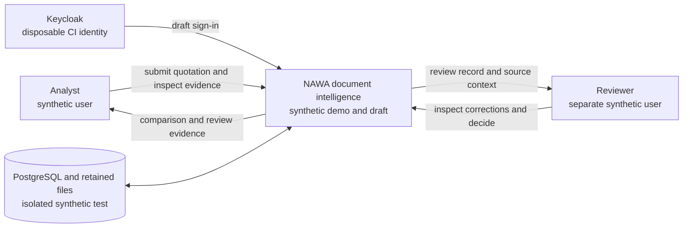
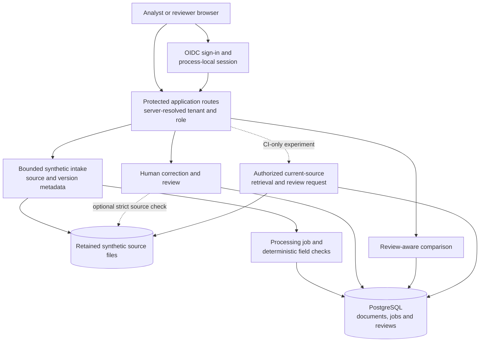
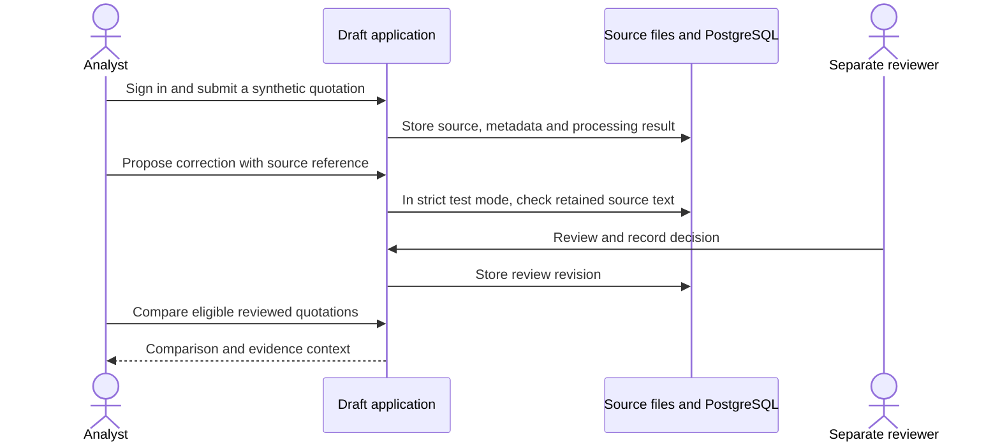

# NAWA quotation review: architecture and evidence map

**Scope:** synthetic document-intelligence portfolio; main revision [`823565f`](https://github.com/zenithdevelopers7-source/nawa-document-intelligence/commit/823565f7c44c15b07719b91670fe8bbfb8d96521) and unmerged integration draft [`9441c12`](https://github.com/zenithdevelopers7-source/nawa-document-intelligence/commit/9441c12891653a1112d75ab04141253adaf23dff), checked 21 November 2026. This is not a diagram of a verified production deployment. The separate v0.6.6 workspace is outside its scope.

## Context: who uses the system

Main provides a fixed-format text demonstration and optional development PostgreSQL storage. Browser identity, retained-source intake and tenant-scoped review are in unmerged drafts. The CI identity provider, certificate, database and files are disposable fixtures. The local demo, the CI setup and any future staging environment have different trust boundaries; no company staging deployment is established here.

## Component map: integration draft

This is a logical map, not a deployment topology or an assurance claim. The strict source check is opt-in and checks retained text; it does not prove semantic correctness or visually verify a PDF. The source-access and pending-request experiment is enabled only in the disposable CI identity stack. Its questions are stored as plaintext and must be synthetic. OCR is review-only and is not a verified financial approval gate. No automated model makes an approval or procurement award in this tested journey.

## Example synthetic journey

The [browser test run](https://github.com/zenithdevelopers7-source/nawa-document-intelligence/actions/runs/44885208486) exercises separate synthetic users and the intake, review and comparison journey; see the [evidence register](NAWA_IMPLEMENTATION_STATUS.md) for exact tests and limitations. A browser test with a disposable certificate does not establish company certificate trust or production identity. Source text and reviewer decisions are distinct: a matching source line is evidence for inspection, not proof that the interpretation is correct.

## Data and authority boundaries

| Item | Current synthetic responsibility | Open production decision |
| --- | --- | --- |
| Identity and tenant | Identity provider authenticates synthetic users; the application resolves membership and role from server-owned records. | Approved identity provider and certificates, distributed sessions and provider-side revocation. |
| Source files and versions | Synthetic intake retains a source in the test file store and records a digest and version metadata. | Storage ownership, encryption, retention, deletion, and consistent database/file recovery. |
| Extraction and financial checks | A bounded synthetic worker produces results; deterministic calculations check financial values. | Independently verified worker origin, isolation, and bilingual financial-field quality gates. |
| Corrections and decisions | A reviewer inspects source-linked correction evidence; revision records represent test decisions. | Approved review policy, audit integrity, retention and separation of duties in the deployed environment. |
| Retrieval and pending requests | The CI-only experiment checks current membership and access to approved current synthetic sources. Pending requests have no completion or approval action. | Atomic authorization and source lifecycle, review-task policy, sensitive-data handling and reliable notifications. |

## State and recovery considerations

A synthetic document follows intake, processing and review as separate steps. A failed or unapproved extraction must not be represented as an approved financial decision. Versions and source withdrawal affect whether experimental retrieval can return evidence. The exact supported states and transitions belong to the implementation and test evidence, not to this conceptual diagram.

Tests have restored a synthetic database and files to a separate target. Another experiment showed that an old database restore can revive access that was subsequently revoked. A production recovery procedure would need a coordinated pause across all relevant processes, consistent database and file recovery, and an explicit reauthorization strategy; those controls are not established by these demonstrations.

For the portfolio, present the working synthetic flow, the exact tested revision and the open decisions together. Review the [implementation status](NAWA_IMPLEMENTATION_STATUS.md), [case study](NAWA_SYNTHETIC_CASE_STUDY.md) and [worker-origin decision draft](NAWA_WORKER_ORIGIN_DECISION.md) before describing a capability as deployed.
